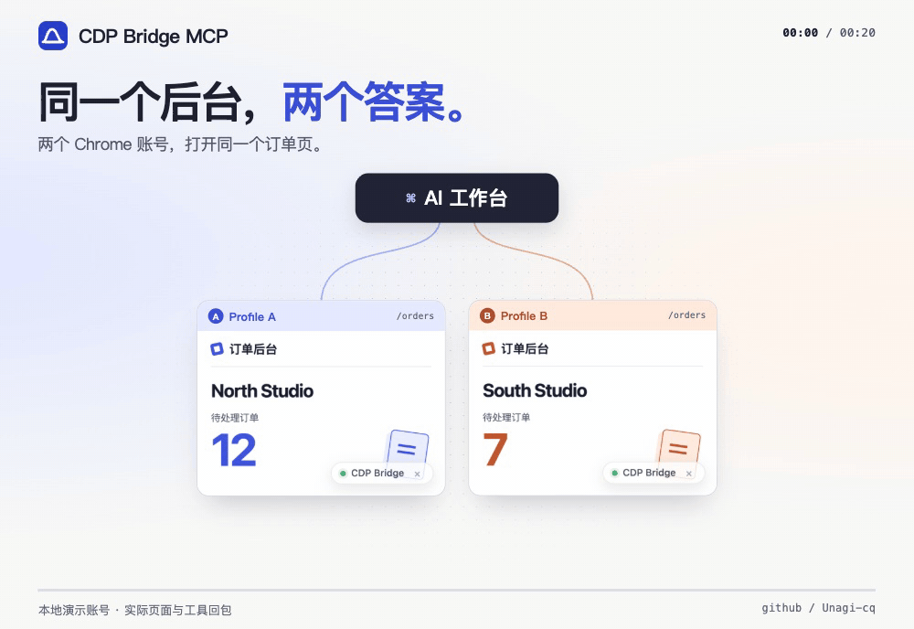
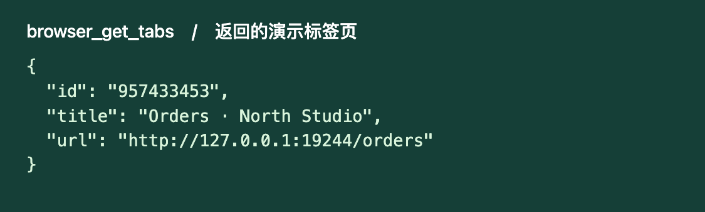
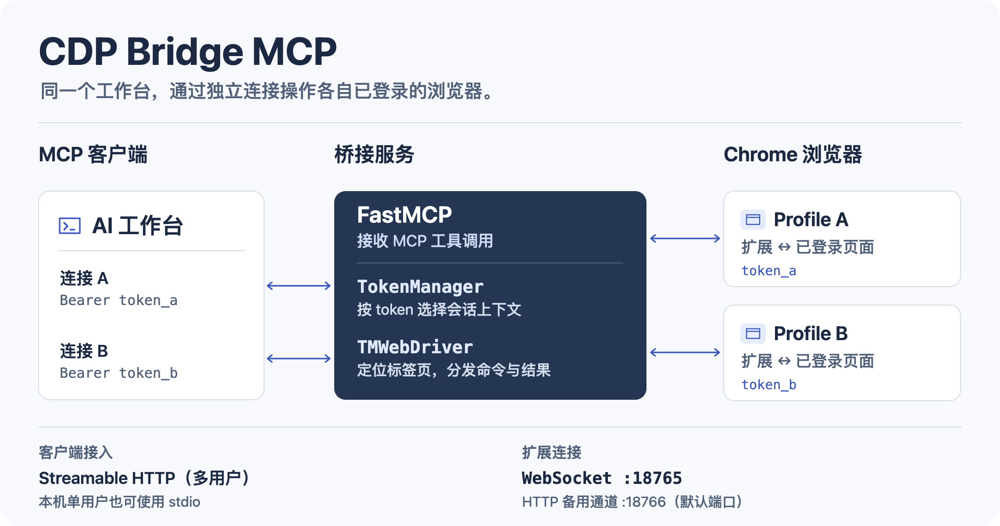
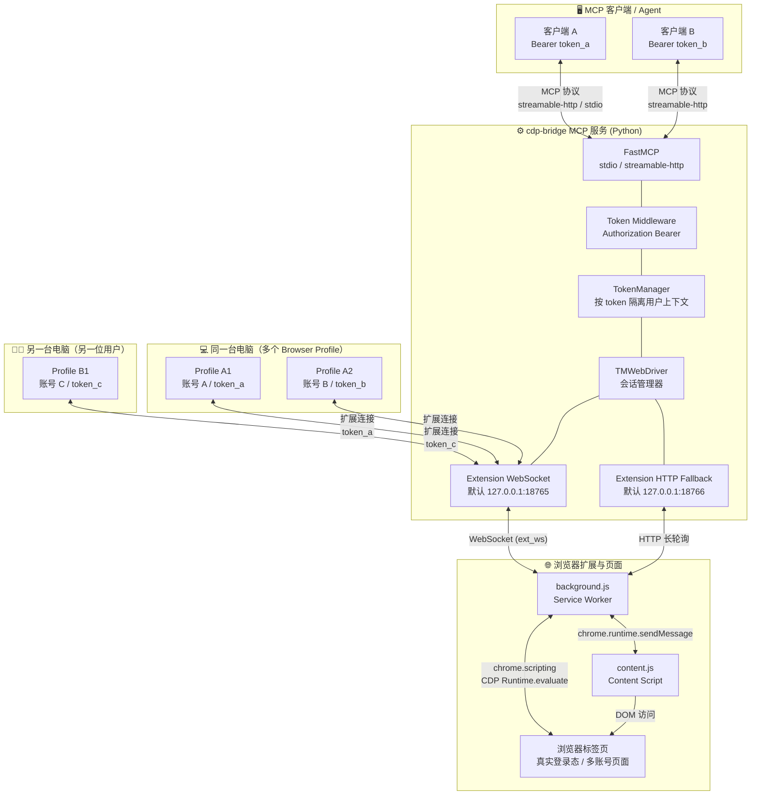
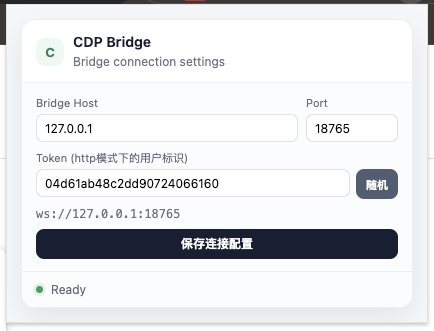

# 让一个 AI 工作台分别操作多个已登录的 Chrome 账号

CDP Bridge MCP · [English](./doc/README_EN.md)



20 秒演示：两个本地测试账号打开相同的网址。蓝线和橙线标出演示请求各自的路径；两张订单页和读回的结果取自实际 MCP 测试。

## 快速安装 · 读出第一个标签页

1. 准备一个用于试用的 Chrome Profile，在装有 [Claude Code](https://code.claude.com/docs/en/quickstart) 和 [uv](https://docs.astral.sh/uv/getting-started/installation/) 的电脑上打开项目终端。扩展可以读取和操作该 Profile 的页面，0.1.25 也会移除其中页面和子框架的 CSP 响应头。
2. [下载 Chrome 扩展 ZIP · v0.1.25](https://github.com/Unagi-cq/cdp-bridge-mcp/releases/download/v0.1.25/cdp-bridge-extension-0.1.25.zip)，解压到一个可以保留的文件夹。打开 `chrome://extensions`，开启 **开发者模式**，选择 **加载已解压的扩展程序**，选中解压后包含 `manifest.json` 的目录。在这个 Profile 打开一个普通网页。
3. 在项目终端执行下面的命令，然后在同一目录新开 Claude Code 会话，按提示启用项目的 MCP 连接。

```sh
claude mcp add --scope project --transport stdio cdp-bridge -- uvx cdp-bridge==0.1.25
```

复制到 Claude Code：

> 列出当前浏览器标签页，告诉我标题。

看到刚才打开的网页标题就成功了。下图展示了一次真实 `browser_get_tabs` 返回中的一个标签页。如果列表为空，保持网页打开，等扩展自动重连后再问一次。



## 接着试双账号

先退出刚才的单账号 Claude Code 会话。在两个 Chrome Profile 里分别加载扩展，用不同测试账号登录同一个网站。在两个扩展弹窗中把 **Port** 都设为 `19245`，**Token** 分别填 `north`、`south`，点击保存连接配置。

在一个终端启动本地服务并保持运行。

```sh
uvx cdp-bridge==0.1.25 --transport streamable-http --port 19240 --ws-port 19245 --tokens north,south
```

在另一个终端进入新的项目目录，添加两条连接。在该目录启动 Claude Code，启用这两项服务。

```sh
claude mcp add --scope project --transport http north http://127.0.0.1:19240/mcp --header "Authorization: Bearer north"
claude mcp add --scope project --transport http south http://127.0.0.1:19240/mcp --header "Authorization: Bearer south"
```

> 分别用 north 和 south 连接读取各自后台上的账号名和待处理订单数，分两行告诉我结果。

## 更多演示

| 单台电脑多个小红书账号同时操作                                     | 查询小红书平台 Anthropic 最新动态                                   | 读取 CSDN 网站作者后台数据分析                                       |
|-----------------------------------------------------|----------------------------------------------------------|----------------------------------------------------------|
| [观看视频](https://www.bilibili.com/video/BV1RDRQBrEY7) | [观看视频](https://www.bilibili.com/video/BV1RDRQBrEY7/?p=3) | [观看视频](https://www.bilibili.com/video/BV1RDRQBrEY7/?p=2) |

## 系统架构

<p align="center">
  
</p>



**数据流简述：**

1. MCP 客户端通过 **stdio**（子进程）或 **streamable-http**（HTTP 端点）连接 `cdp-bridge` 服务；在 `streamable-http` 模式下，客户端可通过 `Authorization: Bearer <token>` 指定自己的用户上下文。
2. 服务端的 `Token Middleware` 负责提取 token，`TokenManager` 负责按 token 隔离会话；同一个 token 下的 MCP 请求和浏览器扩展连接会被路由到同一个上下文。
3. TMWebDriver 启动供浏览器扩展连接的 WebSocket（默认 :18765）和内部 HTTP fallback（默认 :18766）；不同电脑上的用户、或同一台电脑上不同 Browser Profile 的扩展，都可以同时接入。
4. 每个浏览器扩展在连接时会上报自己的 token 和已打开标签页（`ext_ws` 模式）；服务端据此把不同 profile、不同账号、不同用户的真实浏览器页面隔离开来。
5. 当 MCP 工具被调用（如 `browser_execute_js`），服务端只会把 JS 代码发送到当前 token 对应的浏览器会话；扩展的 background.js 优先使用 `chrome.scripting.executeScript` 在页面 MAIN world 执行，若页面有 CSP 限制则自动降级为 CDP `Runtime.evaluate`。
6. 执行结果通过 WebSocket 返回服务端，再由 MCP 协议返回给对应客户端；因此可以同时操作同一平台的多个账号，也可以支持多台电脑上的多用户并发使用而互不干扰。

## 可用工具

MCP 服务当前暴露以下 12 个工具：

| 工具名 | 参数 | 说明 |
| --- | --- | --- |
| `browser_get_tabs` | 无 | 获取所有已连接的浏览器标签页，返回标签页 ID、URL 和标题列表，以及当前活动标签页 |
| `browser_observe` | `tab_id` (str), `limit` (int) | 列出可见交互控件，返回角色、名称、状态、位置、短期引用及 `page_revision`。默认观察 MCP 当前标签页；最多返回 150 个控件 |
| `browser_act` | `tab_id` (str), `page_revision` (str), `ref` (str), `action` (str), `value` (str) | 对 `browser_observe` 返回的控件执行 `click` 或 `fill`，返回操作结果与页面文本变化。引用只能使用一次，有效期 60 秒；失效后重新观察 |
| `browser_scan` | `tabs_only` (bool), `switch_tab_id` (str), `text_only` (bool) | 扫描活动标签页内容。`tabs_only` 仅返回标签页列表节省 token；`text_only` 返回纯文本而非简化 HTML；`switch_tab_id` 在扫描前先切换到指定标签页 |
| `browser_execute_js` | `script` (str, 必填), `switch_tab_id` (str), `no_monitor` (bool) | 在浏览器中执行 JavaScript 并捕获返回值及 DOM 变更 diff。`no_monitor` 跳过 DOM 监控可提速；`switch_tab_id` 先切换到目标标签页再执行 |
| `browser_switch_tab` | `tab_id` (str, 必填) | 切换 MCP 侧的活动标签页（不改变用户在 Chrome 中看到的标签页），后续工具调用将作用于该标签页 |
| `browser_focus_tab` | `tab_id` (str, 必填) | 将 Chrome 标签页置于前台并聚焦窗口，使标签页对用户可见。区别于 `browser_switch_tab`（仅切换 MCP 侧会话），此工具会实际激活 Chrome 窗口和标签页 |
| `browser_batch` | `commands` (list[dict], 必填), `tab_id` (str), `timeout` (float) | 一次请求批量执行多个扩展/CDP 命令，适合需要复用 CDP 上下文的复杂操作链 |
| `browser_wait` | `condition_js` (str, 必填), `timeout` (float), `interval` (float), `switch_tab_id` (str) | 轮询等待 JavaScript 条件表达式返回真值。`timeout` 最长等待秒数（默认 10）；`interval` 检查间隔秒数（默认 0.5） |
| `browser_navigate` | `url` (str, 必填) | 导航活动标签页到指定 URL |
| `browser_screenshot` | `tab_id` (str) | 对活动标签页截图，返回 base64 编码的 PNG 图片数据 |
| `browser_save_image` | `screenshot_json_str_or_file` (str, 必填), `output_path` (str) | 将 `browser_screenshot` 返回的 base64 截图数据保存为本地 PNG 文件。`screenshot_json_str_or_file` 为截图 JSON 字符串或 JSON 文件路径；`output_path` 为输出路径或目录 |

语义操作流程：先调用 `browser_observe`，从结果中选择控件的 `ref`，再把同一结果中的 `tab_id` 和 `page_revision` 传给 `browser_act`。操作后重新观察。当前版本支持页面主文档与开放的 Shadow DOM；iframe 内的控件尚未包含在结果中。

## 加载浏览器

在 Chrome 或其他 Chromium 浏览器中加载：

1. 打开 `chrome://extensions/`。
2. 开启“开发者模式”。
3. 点击“加载已解压的扩展程序”。
4. 选择 `src/cdp_bridge/tmwd_cdp_bridge` 文件夹。

默认情况下，扩展会连接本地 WebSocket 服务 `127.0.0.1:18765`。

扩展弹窗里可以修改连接配置：

<p align="center">
  
</p>

- `Bridge Host`：可填写 `127.0.0.1`、`localhost` 或域名。填写域名时可以不填端口，例如 `bridge.example.com`。
- `Port`：WebSocket 端口。使用本地默认配置时是 `18765`；如果 MCP 启动时使用了 `--ws-port`，这里需要填同一个端口。域名接入并且服务走默认 WebSocket 端口时，可以留空。
- `Token`：`streamable-http` 多用户模式下用于把浏览器扩展和 MCP 客户端绑定到同一个用户上下文。留空时扩展会自动写入默认值 `__default__`。如果你使用 Bearer token 访问远端 MCP 服务，这里必须填写和客户端完全一致的 token。

## 配置 MCP

先确认电脑上已安装 `uv`。CDP Bridge MCP 通过 `uvx cdp-bridge@latest` 启动。

### 两种传输模式

CDP Bridge 支持两种 MCP 传输模式，可根据使用场景选择：

| 模式 | 原理 | 适用场景 |
|------|------|----------|
| `stdio`（默认） | MCP 客户端以子进程启动服务，通过标准输入/输出通信 | Claude Desktop、Claude Code、Codex 等本地客户端 |
| `streamable-http` | 服务以独立 HTTP 进程运行，客户端通过 HTTP 请求连接 | 多客户端共享、Docker 部署、服务常驻 |

### 启动参数

| 参数 | 默认值 | 适用模式 | 说明 |
| --- | --- | --- | --- |
| `--transport` | `stdio` | 两种模式 | MCP 传输模式。可选 `stdio` 或 `streamable-http`。 |
| `--ws-port` | `18765` | 两种模式 | 浏览器扩展连接的 WebSocket 端口。无论使用 `stdio` 还是 `streamable-http`，都可以配置。 |
| `--port` | `8000` | 仅 `streamable-http` | MCP HTTP 服务端口。只在 `--transport streamable-http` 时使用，客户端连接地址是 `http://127.0.0.1:<port>/mcp`。 |
| `--tokens` | 空 | 仅 `streamable-http` | 允许接入的 token 白名单，多个 token 用英文逗号分隔；为空时接受任意 token。 |
| --host | 127.0.0.1 | 仅 `streamable-http` | 默认`streamable-http`启动时监听的是127.0.0.1，无法进行远程访问。通过增加该参数，可指定监听的ip，可配置为0.0.0.0监听所有网卡的ip。 |

注意：`--ws-port` 是浏览器扩展连接后端的端口；`--port` 是 MCP 客户端连接后端的 HTTP 端口。两者不是同一个端口。

### 脚本测试

```bash
# stdio 模式（默认）
uvx cdp-bridge@latest

# stdio 模式，指定 WebSocket 端口
uvx cdp-bridge@latest --ws-port 18767

# streamable-http 模式，指定 MCP HTTP 端口
uvx cdp-bridge@latest --transport streamable-http --port 8000

# streamable-http 模式，同时指定 MCP HTTP 端口和浏览器扩展 WebSocket 端口
uvx cdp-bridge@latest --transport streamable-http --port 8000 --ws-port 18767

# streamable-http 模式，只允许指定 token 接入
uvx cdp-bridge@latest --transport streamable-http --port 8000 --tokens "team_alice,team_bob"

# streamable-http 模式，同时指定 MCP HTTP 端口和监听的ip，远程机器可通过172.25.240.1:8000访问运行的MCP Server
uvx cdp-bridge@latest --transport streamable-http --host 172.25.240.1 --port 8000

# 也可以通过环境变量传入 token 白名单
CDP_BRIDGE_TOKENS="team_alice,team_bob" uvx cdp-bridge@latest --transport streamable-http --port 8000
```

不传 `--transport` 时默认使用 `stdio`。`stdio` 模式没有 MCP HTTP 端口；`streamable-http` 模式的 MCP 服务地址为 `http://127.0.0.1:<port>/mcp`。

### MCP 对比测评（V3）

V3 修正了 V2 “只要模型返回非空文本就算成功”的统计问题，改用场景级验收规则，并把场景分为确定性核心对比、真实登录态诊断和标签页诊断。核心对比会记录通过率、质量、工具成功率、API 轮次、Token 和耗时，同时生成 Markdown 报告与结构化 JSON。默认测试当前工作区源码，并固定 Playwright MCP 版本，避免 `latest` 漂移。

```bash
export ANTHROPIC_API_KEY="你的 API Key"
export ANTHROPIC_BASE_URL="https://api.deepseek.com/anthropic"  # 可选
export ANTHROPIC_MODEL="deepseek-v4-pro"                       # 可选

# 只做前置检查和本地构建，不调用 LLM
uv run python reports/V-003-2026-08-09/eval_mcp_compare_v3.py --preflight --build-check

# 核心对比，默认每个场景重复 3 次
uv run python reports/V-003-2026-08-09/eval_mcp_compare_v3.py --repeats 3

# 加入真实登录态和标签页诊断场景
uv run python reports/V-003-2026-08-09/eval_mcp_compare_v3.py --suite all --repeats 3
```

查看 [V3 测试报告](reports/V-003-2026-08-09/eval_compare_report.md) 和 [V3 测评脚本](reports/V-003-2026-08-09/eval_mcp_compare_v3.py)。脚本运行时还会在同一目录生成 `eval_results.json`；默认不保存完整工具正文，避免把真实标签页或页面隐私写入结果，确需审计时可增加 `--save-tool-output`。

2026-08-09 的 V3 样例使用 `cdp-bridge 0.1.23`、Playwright MCP `0.0.79` 和 `deepseek-v4-pro`，在 `core` 模式下对 3 个场景各重复 3 次，共执行 18 次任务。两侧任务通过率和平均质量均为 **100% / 1.00**。

下表依次列出“中位耗时 / 平均工具调用 / 工具成功率 / 中位总 Token”：

| 场景 | CDP Bridge | Playwright |
|---|---:|---:|
| 本地确定性内容提取 | 12.56s / 2.0 / 100.0% / 940 | 11.03s / 2.0 / 100.0% / 773 |
| 本地确定性交互 | 16.37s / 3.0 / 100.0% / 1,084 | 22.54s / 5.0 / 80.0% / 1,451 |
| NumPy 外部页面 | 37.24s / 4.7 / 100.0% / 7,212 | 60.52s / 8.0 / 83.3% / 21,535 |

本次运行中，Playwright 在简单内容提取场景耗时和 Token 更低；CDP Bridge 在交互与外部页面场景使用了更少的工具调用和 Token，并取得更低的中位耗时与更高的工具成功率。以上是特定模型、网络和浏览器会话下的端到端结果，不代表通用性能结论；真实登录态与标签页场景属于诊断项，未计入本次核心质量排名。

<details>
<summary>V2 测评说明与历史样例</summary>

### MCP 对比测评（V2）

仓库提供了 V2 测评脚本，用相同的用户 query、LLM 和 MCP 工具调用循环，对比 CDP Bridge 与 Playwright MCP 的实际任务表现。测评记录以下指标：

- 任务成功率、答案质量分数
- API 调用轮次、工具调用次数及工具成功率
- 输入/输出 Token 和总耗时
- 每一次工具调用的参数、耗时、返回字符数和错误信息

脚本位置：[reports/V-002-2026-07-12/eval_mcp_compare_v2.py](reports/V-002-2026-07-12/eval_mcp_compare_v2.py)。运行完整测评前，需要准备浏览器扩展、CDP Bridge 服务、Playwright MCP、Anthropic 兼容 API，以及 `ANTHROPIC_API_KEY`：

```bash
export ANTHROPIC_API_KEY="你的 API Key"
export ANTHROPIC_BASE_URL="https://api.deepseek.com/anthropic"  # 可选
export ANTHROPIC_MODEL="deepseek-v4-pro"                       # 可选

# 默认 3 个场景，每个场景重复 3 次
python reports/V-002-2026-07-12/eval_mcp_compare_v2.py

# 只测某个场景，或只测一侧
python reports/V-002-2026-07-12/eval_mcp_compare_v2.py --case numpy --repeats 3
python reports/V-002-2026-07-12/eval_mcp_compare_v2.py --cdp-only

# 只检查依赖并生成报告，不调用 LLM
python reports/V-002-2026-07-12/eval_mcp_compare_v2.py --preflight
```

报告会写入 [reports/V-002-2026-07-12/eval_compare_report.md](reports/V-002-2026-07-12/eval_compare_report.md)。V2 的示例运行结果（2026-07-12、每个场景 1 次）如下，数值仅用于说明该次环境下的观测，不代表所有网络、浏览器登录态或模型配置：

| 场景 | CDP Bridge | Playwright | 观测 |
|---|---:|---:|---|
| 小红书首页首条内容 | 14.2s / 3 次工具调用 | 37.4s / 5 次工具调用 | CDP Bridge 更快、调用更少；页面内容受风控和登录态影响 |
| 菜鸟教程 NumPy 位运算 | 29.9s / 5 次调用 / 10,315 Token | 68.1s / 10 次调用 / 18,647 Token | CDP Bridge 在该场景耗时、调用次数和 Token 更低 |
| 当前标签页列表 | 8.8s / 1 次调用 | 4.4s / 1 次调用 | Playwright 更快；两侧浏览器会话中的标签页数量并不等价 |

测评中的“答案质量”是基于场景验收词的可解释启发式分数，不替代人工核验。CDP Bridge 连接用户的真实浏览器会话，而 Playwright 通常使用独立浏览器环境；两者的 Cookie、缓存、页面推荐流、网络和安全策略可能不同，因此该测评是端到端工作流参考，不是纯协议或浏览器引擎基准。

</details>

### Token 与多用户隔离

`streamable-http` 模式下，服务端会按 token 隔离浏览器会话空间。

- MCP 客户端通过 HTTP 请求头传 token：`Authorization: Bearer <token>`
- 浏览器扩展通过弹窗里的 `Token` 字段传同一个 token
- **客户端 token 和扩展 token 必须完全一致**，这样服务端才能把它们路由到同一个用户上下文
- 如果扩展里没有填写 token，会自动使用默认值 `__default__`
- 如果服务端没有配置 `--tokens`，任何 token 都可以接入；配置了 `--tokens` 后，只允许白名单中的 token
- 在**同一台电脑**上，你可以让不同浏览器 Profile 使用不同 token，从而并行操作同一个平台的多个账号
- 在**不同电脑**上，你也可以让多个用户分别连接到同一个 `streamable-http` 服务，并通过不同 token 实现隔离

### 标准配置

**stdio 模式：**

```json
{
  "mcpServers": {
    "cdp-bridge": {
      "command": "uvx",
      "args": ["cdp-bridge@latest"]
    }
  }
}
```

如果需要修改浏览器扩展连接的 WebSocket 端口，把 `--ws-port` 加到 `args` 里：

```json
{
  "mcpServers": {
    "cdp-bridge": {
      "command": "uvx",
      "args": ["cdp-bridge@latest", "--ws-port", "18767"]
    }
  }
}
```

**streamable-http 模式：**

先启动服务：
```bash
uvx cdp-bridge@latest --transport streamable-http --port 8000
```

如果同时要修改浏览器扩展连接的 WebSocket 端口：

```bash
uvx cdp-bridge@latest --transport streamable-http --port 8000 --ws-port 18767
```

再配置客户端连接：
```json
{
  "mcpServers": {
    "cdp-bridge": {
      "type": "streamableHttp",
      "url": "http://127.0.0.1:8000/mcp"
    }
  }
}
```

如果你启用了多用户隔离，客户端应显式携带 Bearer token：
```json
{
  "mcpServers": {
    "cdp-bridge": {
      "type": "streamableHttp",
      "url": "http://127.0.0.1:8000/mcp",
      "headers": {
        "Authorization": "Bearer team_alice"
      }
    }
  }
}
```

此时浏览器扩展弹窗中的 `Token` 也要填写成 `team_alice`。

### Claude Code

**方式一：命令行添加**

```bash
# stdio 模式
claude mcp add --transport stdio cdp-bridge -- uvx cdp-bridge==0.1.25

# streamable-http 模式（先启动服务，再注册）
claude mcp add --transport http cdp-bridge http://127.0.0.1:8000/mcp
```

**方式二：配置文件（推荐用于 streamable-http 模式）**

在 `~/.claude.json` 中添加 `mcpServers` 配置：

```json
{
  "mcpServers": {
    "cdp-bridge": {
      "type": "http",
      "url": "http://127.0.0.1:8000/mcp"
    }
  }
}
```

> 注意：使用配置文件方式时，需要先启动 `cdp-bridge` 服务（`uvx cdp-bridge@latest --transport streamable-http --port 8000 --ws-port 18765`），然后重启 Claude Code。

### Codex

```bash
# stdio 模式
codex mcp add cdp-bridge uvx cdp-bridge@latest

# streamable-http 模式
codex mcp add cdp-bridge --transport streamable-http --url http://127.0.0.1:8000/mcp
```

### opencode

在 `~/.config/opencode/opencode.json` 里配置：

**stdio 模式：**
```json
{
  "$schema": "https://opencode.ai/config.json",
  "mcp": {
    "cdp-bridge": {
      "type": "local",
      "command": [
        "uvx",
        "cdp-bridge@latest"
      ],
      "enabled": true
    }
  }
}
```

**streamable-http 模式：**
```json
{
  "$schema": "https://opencode.ai/config.json",
  "mcp": {
    "cdp-bridge": {
      "type": "remote",
      "url": "http://127.0.0.1:8000/mcp",
      "enabled": true
    }
  }
}
```

### OpenClaw

可以使用 OpenClaw CLI 写入 MCP 配置：

```bash
# stdio 模式
openclaw mcp set cdp-bridge '{"command":"uvx","args":["cdp-bridge@latest"]}'

# streamable-http 模式
openclaw mcp set cdp-bridge '{"transport":"streamable-http","url":"http://remoteip:8000/mcp"}'
```

等价的 stdio 配置结构：
```json
{
  "mcp": {
    "servers": {
      "cdp-bridge": {
        "command": "uvx",
        "args": ["cdp-bridge@latest"]
      }
    }
  }
}
```

### 注意事项

- 本项目需要 Python 3.10 或更高版本。
- 浏览器扩展内置自动重连机制：首次连接失败后会持续探测 WebSocket 服务（每 ~5 秒），当 MCP 服务启动后会自动恢复连接。如果看到 ERR_CONNECTION_REFUSED，等待数秒即可自动恢复。
- 页面自动化会运行在你的真实浏览器会话中，请只连接你信任的 MCP 客户端。

## 致谢

本项目的浏览器插件和部分代码参考并来源于 [GenericAgent](https://github.com/lsdefine/GenericAgent)。感谢原项目作者的开源工作。
