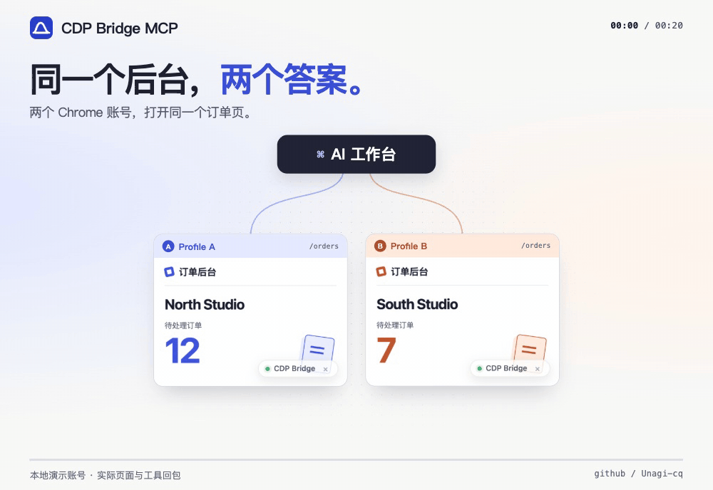
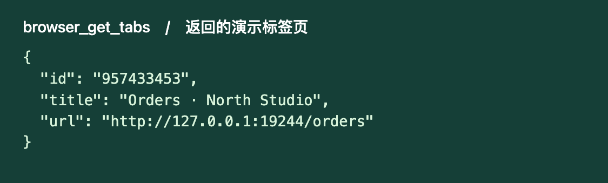
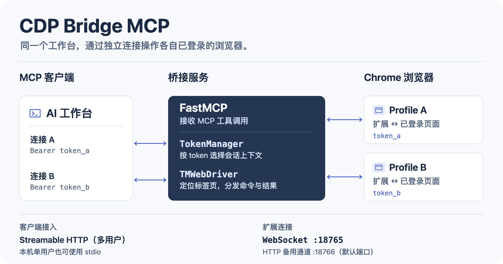
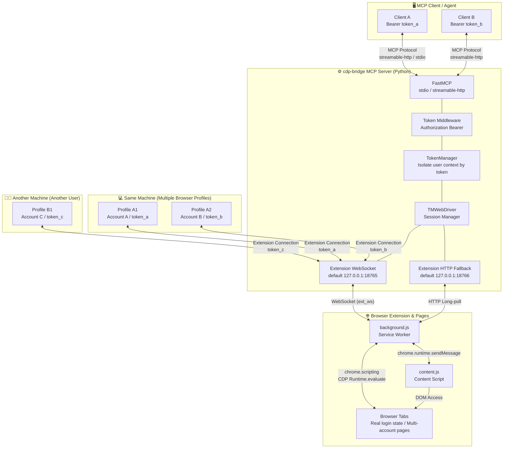
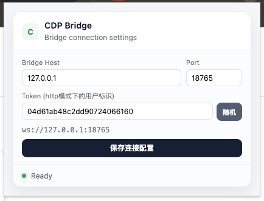

# Use one AI workspace across multiple signed-in Chrome accounts

[中文](../README.md) · CDP Bridge MCP



Two local demo accounts share the same dashboard URL. The 20-second walkthrough pairs screenshots from separate Chrome profiles with the results of two MCP requests.

## Quick install · read your first tab

1. Open a terminal in your Claude Code project. You’ll need [Claude Code](https://code.claude.com/docs/en/quickstart), [uv](https://docs.astral.sh/uv/getting-started/installation/) and a Chrome profile for testing. The extension can read and act on pages in that profile. Version 0.1.25 also removes Content Security Policy headers for frames in that profile.
2. [Download the Chrome extension ZIP · v0.1.25](https://github.com/Unagi-cq/cdp-bridge-mcp/releases/download/v0.1.25/cdp-bridge-extension-0.1.25.zip). Extract it to a folder you can keep. Open `chrome://extensions`, enable **Developer mode**, choose **Load unpacked**, and select the folder containing `manifest.json`. Open a regular website in that profile.
3. Register the MCP server in your project, then start a new Claude Code session there and approve the project MCP connection when prompted.

```sh
claude mcp add --scope project --transport stdio cdp-bridge -- uvx cdp-bridge==0.1.25
```

Ask Claude Code:

> List my current browser tabs and tell me their titles.

Look for the title of the page you opened. Below is one tab from an actual `browser_get_tabs` response. If the list is empty, leave the site open, wait for the extension to reconnect, and ask again.



## Try two accounts on one computer

Close the single-profile Claude Code session first. In two Chrome profiles, load the extension and sign into different demo accounts on the same site. In each extension popup, set **Port** to `19245` and save a different **Token**. The local demo uses `north` and `south`.

Start the shared local service and leave it running.

```sh
uvx cdp-bridge==0.1.25 --transport streamable-http --port 19240 --ws-port 19245 --tokens north,south
```

In a fresh project directory, register both connections. Open Claude Code there and enable both servers.

```sh
claude mcp add --scope project --transport http north http://127.0.0.1:19240/mcp --header "Authorization: Bearer north"
claude mcp add --scope project --transport http south http://127.0.0.1:19240/mcp --header "Authorization: Bearer south"
```

> Use the north and south connections to read the dashboard account name and open order count on each. List the results separately.

## More demos

| Multi-account operations on Xiaohongshu from a single machine | Search Anthropic updates on Xiaohongshu | Read CSDN author analytics |
|---------------------------------------------------------------|------------------------------------------|-----------------------------|
| [Watch video](https://www.bilibili.com/video/BV1RDRQBrEY7) | [Watch video](https://www.bilibili.com/video/BV1RDRQBrEY7/?p=3) | [Watch video](https://www.bilibili.com/video/BV1RDRQBrEY7/?p=2) |

## System Architecture

<p align="center">
  
</p>



**Data Flow Summary:**

1. The MCP client connects to the `cdp-bridge` service via **stdio** (subprocess) or **streamable-http** (HTTP endpoint). In `streamable-http` mode, the client specifies its user context with the `Authorization: Bearer <token>` header.
2. The server's `Token Middleware` extracts the token, and `TokenManager` isolates sessions by token. MCP requests and browser extension connections under the same token are routed to the same context.
3. TMWebDriver starts the browser-extension WebSocket (default :18765) and internal HTTP fallback (default :18766). Users on different machines, or different Browser Profiles on the same machine, can all connect simultaneously.
4. Each browser extension reports its token and open tabs upon connection (`ext_ws` mode). The server uses this to isolate real browser pages across different profiles, accounts, and users.
5. When an MCP tool is called (e.g. `browser_execute_js`), the server only sends JavaScript to the browser session matching the current token. The extension's background.js first tries `chrome.scripting.executeScript` in the page's MAIN world, and automatically falls back to CDP `Runtime.evaluate` if the page has CSP restrictions.
6. Execution results are returned to the server through WebSocket, then relayed to the corresponding client through the MCP protocol. This allows simultaneous multi-account operations on the same platform and concurrent multi-user access from different machines without interference.

## Available Tools

The MCP service currently exposes 12 tools:

| Tool | Parameters | Description |
| --- | --- | --- |
| `browser_get_tabs` | None | Get all connected browser tabs with their IDs, URLs, and titles, plus the currently active tab |
| `browser_observe` | `tab_id` (str), `limit` (int) | List visible interactive controls with roles, names, states, positions, short-lived references, and a `page_revision`. Uses the active MCP tab by default; returns up to 150 controls |
| `browser_act` | `tab_id` (str), `page_revision` (str), `ref` (str), `action` (str), `value` (str) | `click` or `fill` a control returned by `browser_observe`, with the result and page text changes. References are single-use and expire after 60 seconds; observe again when stale |
| `browser_scan` | `tabs_only` (bool), `switch_tab_id` (str), `text_only` (bool) | Scan the active tab's content. `tabs_only` returns only the tab list to save tokens; `text_only` returns plain text instead of simplified HTML; `switch_tab_id` switches to the given tab before scanning |
| `browser_execute_js` | `script` (str, required), `switch_tab_id` (str), `no_monitor` (bool) | Execute JavaScript in the browser and capture the return value plus DOM change diff. `no_monitor` skips DOM monitoring for speed; `switch_tab_id` switches to the target tab first |
| `browser_switch_tab` | `tab_id` (str, required) | Switch the MCP-side active tab (does not change what the user sees in Chrome). Subsequent tool calls will target this tab |
| `browser_focus_tab` | `tab_id` (str, required) | Bring a Chrome tab to the foreground and focus its window, making it visible to the user. Unlike `browser_switch_tab` (which only changes the MCP-side session), this actually activates the Chrome window and tab |
| `browser_batch` | `commands` (list[dict], required), `tab_id` (str), `timeout` (float) | Run multiple extension/CDP commands in a single request, ideal for complex operation chains that reuse CDP context |
| `browser_wait` | `condition_js` (str, required), `timeout` (float), `interval` (float), `switch_tab_id` (str) | Poll a JavaScript condition expression until it returns a truthy value. `timeout` max wait in seconds (default 10); `interval` check interval in seconds (default 0.5) |
| `browser_navigate` | `url` (str, required) | Navigate the active tab to a URL |
| `browser_screenshot` | `tab_id` (str) | Capture a screenshot of the active tab, returns base64-encoded PNG image data |
| `browser_save_image` | `screenshot_json_str_or_file` (str, required), `output_path` (str) | Save the base64 screenshot data from `browser_screenshot` as a local PNG file. `screenshot_json_str_or_file` is the screenshot JSON string or JSON file path; `output_path` is the output file path or directory |

For semantic actions, call `browser_observe`, select a control `ref`, then pass its `tab_id` and `page_revision` to `browser_act`. Observe again after each action. The current version covers the main document and open Shadow DOM; controls inside iframes are not included.

## Load the Browser Extension

In Chrome or another Chromium-based browser:

1. Open `chrome://extensions/`.
2. Enable "Developer mode".
3. Click "Load unpacked".
4. Select the `src/cdp_bridge/tmwd_cdp_bridge` folder.

By default, the extension connects to the local WebSocket service at `127.0.0.1:18765`.

You can change the connection settings from the extension popup:

<p align="center">
  
</p>

- `Bridge Host`: Can be `127.0.0.1`, `localhost`, or a domain name. When using a domain, the port can be omitted, e.g. `bridge.example.com`.
- `Port`: The WebSocket port. The local default is `18765`. If the MCP service was started with `--ws-port`, set the same port here. For a domain-based setup using the default WebSocket port, this field can be left empty.
- `Token`: In `streamable-http` multi-user mode, this binds the browser extension and MCP client to the same user context. When left empty, the extension automatically fills in the default value `__default__`. If you use a Bearer token to access a remote MCP service, this field must match the client's token exactly.

## Configure MCP

First, make sure `uv` is installed. CDP Bridge MCP is started through `uvx cdp-bridge@latest`.

### Two Transport Modes

CDP Bridge supports two MCP transport modes. Choose based on your use case:

| Mode | How it Works | Best For |
|------|-------------|----------|
| `stdio` (default) | MCP client launches the server as a subprocess, communicating over stdin/stdout | Claude Desktop, Claude Code, Codex, and other local clients |
| `streamable-http` | Server runs as a standalone HTTP process, clients connect via HTTP requests | Multi-client sharing, Docker deployments, persistent services |

### Startup Parameters

| Parameter | Default | Applies To | Description |
| --- | --- | --- | --- |
| `--transport` | `stdio` | Both modes | MCP transport mode. Choose `stdio` or `streamable-http`. |
| `--ws-port` | `18765` | Both modes | WebSocket port used by the browser extension. Configurable in either `stdio` or `streamable-http` mode. |
| `--port` | `8000` | `streamable-http` only | MCP HTTP service port. Only used with `--transport streamable-http`. The client URL is `http://127.0.0.1:<port>/mcp`. |
| `--tokens` | empty | `streamable-http` only | Comma-separated whitelist of allowed tokens. When empty, any token is accepted. |

Note: `--ws-port` is the port the browser extension connects to on the backend; `--port` is the HTTP port MCP clients connect to. They are not the same port.

### Script Test

```bash
# stdio mode (default)
uvx cdp-bridge@latest

# stdio mode with a custom WebSocket port
uvx cdp-bridge@latest --ws-port 18767

# streamable-http mode with a custom MCP HTTP port
uvx cdp-bridge@latest --transport streamable-http --port 8000

# streamable-http mode with both MCP HTTP port and browser-extension WebSocket port
uvx cdp-bridge@latest --transport streamable-http --port 8000 --ws-port 18767

# streamable-http mode, only allow specific tokens
uvx cdp-bridge@latest --transport streamable-http --port 8000 --tokens "team_alice,team_bob"

# You can also pass the token whitelist via environment variable
CDP_BRIDGE_TOKENS="team_alice,team_bob" uvx cdp-bridge@latest --transport streamable-http --port 8000
```

When `--transport` is omitted, `stdio` is used by default. `stdio` mode has no MCP HTTP port. In `streamable-http` mode, the MCP service URL is `http://127.0.0.1:<port>/mcp`.

### MCP Benchmark (V3)

V3 replaces V2's “non-empty answer means success” rule with case-specific acceptance criteria. It separates deterministic core cases from live-session and tab diagnostics, pins the Playwright MCP version, alternates backend order, and writes both a Markdown report and structured JSON results.

```bash
# Preflight and package build only; does not call the LLM API
uv run python reports/V-003-2026-08-09/eval_mcp_compare_v3.py --preflight --build-check

# Core comparison, three repeats per case
ANTHROPIC_API_KEY=... uv run python reports/V-003-2026-08-09/eval_mcp_compare_v3.py --repeats 3

# Include live-session and tab diagnostics
ANTHROPIC_API_KEY=... uv run python reports/V-003-2026-08-09/eval_mcp_compare_v3.py --suite all --repeats 3
```

See [the V3 report](../reports/V-003-2026-08-09/eval_compare_report.md) and [the V3 harness](../reports/V-003-2026-08-09/eval_mcp_compare_v3.py). Each run also generates `eval_results.json` in the same directory. Full tool output is omitted by default to avoid writing private page or tab content into the results; use `--save-tool-output` only when that content is required for an audit.

The V3 sample run on August 9, 2026 used `cdp-bridge 0.1.23`, Playwright MCP `0.0.79`, and `deepseek-v4-pro`. It repeated three core scenarios three times per backend, for 18 task runs in total. Both backends achieved a **100% task pass rate and a 1.00 average quality score**.

Each cell below shows median wall-clock time / average tool calls / tool success rate / median total tokens:

| Scenario | CDP Bridge | Playwright |
|---|---:|---:|
| Deterministic local extraction | 12.56s / 2.0 / 100.0% / 940 | 11.03s / 2.0 / 100.0% / 773 |
| Deterministic local interaction | 16.37s / 3.0 / 100.0% / 1,084 | 22.54s / 5.0 / 80.0% / 1,451 |
| External NumPy page | 37.24s / 4.7 / 100.0% / 7,212 | 60.52s / 8.0 / 83.3% / 21,535 |

In this run, Playwright used less time and fewer tokens for simple content extraction. CDP Bridge used fewer tool calls and tokens in the interaction and external-page scenarios, with lower median latency and a higher tool success rate. These are end-to-end observations for a specific model, network, and browser session, not universal performance claims. Live-login and tab scenarios are diagnostics and were excluded from the core quality ranking.

<details>
<summary>V2 evaluation notes and historical sample</summary>

### MCP Benchmark (V2)

This repository includes a V2 evaluation script that compares CDP Bridge and Playwright MCP using the same user queries, LLM, and tool-calling loop. It records:

- task success rate and an interpretable answer-quality score;
- API rounds, tool-call count, and tool success rate;
- input/output tokens and wall-clock time;
- per-call tool arguments, latency, returned character count, and errors.

The script is available at [`reports/V-002-2026-07-12/eval_mcp_compare_v2.py`](../reports/V-002-2026-07-12/eval_mcp_compare_v2.py). Before running the full benchmark, prepare the browser extension, a CDP Bridge service, Playwright MCP, an Anthropic-compatible API, and `ANTHROPIC_API_KEY`:

```bash
export ANTHROPIC_API_KEY="your API key"
export ANTHROPIC_BASE_URL="https://api.deepseek.com/anthropic"  # optional
export ANTHROPIC_MODEL="deepseek-v4-pro"                       # optional

# Three scenarios, repeated three times by default
python reports/V-002-2026-07-12/eval_mcp_compare_v2.py

# Select a scenario, or benchmark only one backend
python reports/V-002-2026-07-12/eval_mcp_compare_v2.py --case numpy --repeats 3
python reports/V-002-2026-07-12/eval_mcp_compare_v2.py --cdp-only

# Check prerequisites and generate a report without calling the LLM
python reports/V-002-2026-07-12/eval_mcp_compare_v2.py --preflight
```

The report is written to [`reports/V-002-2026-07-12/eval_compare_report.md`](../reports/V-002-2026-07-12/eval_compare_report.md). The sample run (July 12, 2026, one repetition per scenario) produced the following observations. These numbers describe that environment only; they are not universal results across networks, browser sessions, or model configurations:

| Scenario | CDP Bridge | Playwright | Observation |
|---|---:|---:|---|
| First item on Xiaohongshu home page | 14.2s / 3 tool calls | 37.4s / 5 tool calls | CDP Bridge was faster and used fewer calls; content depends on login state and anti-bot controls |
| Runoob NumPy bitwise-operations tutorial | 29.9s / 5 calls / 10,315 tokens | 68.1s / 10 calls / 18,647 tokens | CDP Bridge was lower on latency, calls, and tokens in this scenario |
| Current browser tabs | 8.8s / 1 call | 4.4s / 1 call | Playwright was faster; the two browser sessions did not expose the same tab set |

The benchmark's answer-quality score is an interpretable heuristic based on scenario-specific acceptance terms, not a substitute for human review. CDP Bridge connects to the user's real browser session, while Playwright normally uses an isolated browser environment; cookies, cache, page recommendations, network conditions, and security policies can differ. Treat this as an end-to-end workflow reference, not as a pure protocol or browser-engine benchmark.

</details>

### Token & Multi-User Isolation

In `streamable-http` mode, the server isolates browser session spaces by token.

- MCP clients pass the token via HTTP header: `Authorization: Bearer <token>`
- Browser extensions pass the same token via the `Token` field in the popup
- **The client token and extension token must match exactly** so the server can route them to the same user context
- If the extension's `Token` field is left empty, it defaults to `__default__`
- If the server is not configured with `--tokens`, any token is accepted. With `--tokens`, only whitelisted tokens are allowed
- On the **same machine**, you can have different Browser Profiles use different tokens to operate multiple accounts on the same platform in parallel
- On **different machines**, multiple users can connect to the same `streamable-http` service and be isolated by their respective tokens

### Standard Configuration

**stdio mode:**

```json
{
  "mcpServers": {
    "cdp-bridge": {
      "command": "uvx",
      "args": ["cdp-bridge@latest"]
    }
  }
}
```

If you need to change the WebSocket port used by the browser extension, add `--ws-port` to `args`:

```json
{
  "mcpServers": {
    "cdp-bridge": {
      "command": "uvx",
      "args": ["cdp-bridge@latest", "--ws-port", "18767"]
    }
  }
}
```

**streamable-http mode:**

First start the service:

```bash
uvx cdp-bridge@latest --transport streamable-http --port 8000
```

If you also need to change the WebSocket port used by the browser extension:

```bash
uvx cdp-bridge@latest --transport streamable-http --port 8000 --ws-port 18767
```

Then configure the client to connect:

```json
{
  "mcpServers": {
    "cdp-bridge": {
      "type": "streamableHttp",
      "url": "http://127.0.0.1:8000/mcp"
    }
  }
}
```

If you have enabled multi-user isolation, the client should explicitly carry a Bearer token:

```json
{
  "mcpServers": {
    "cdp-bridge": {
      "type": "streamableHttp",
      "url": "http://127.0.0.1:8000/mcp",
      "headers": {
        "Authorization": "Bearer team_alice"
      }
    }
  }
}
```

In this case, the `Token` field in the browser extension popup must also be set to `team_alice`.

### Claude Code

```bash
# stdio mode
claude mcp add --transport stdio cdp-bridge -- uvx cdp-bridge==0.1.25

# streamable-http mode (start the service first, then register it)
claude mcp add --transport http cdp-bridge http://127.0.0.1:8000/mcp
```

### Codex

```bash
# stdio mode
codex mcp add cdp-bridge uvx cdp-bridge@latest

# streamable-http mode
codex mcp add cdp-bridge --transport streamable-http --url http://127.0.0.1:8000/mcp
```

### opencode

Configure it in `~/.config/opencode/opencode.json`:

**stdio mode:**

```json
{
  "$schema": "https://opencode.ai/config.json",
  "mcp": {
    "cdp-bridge": {
      "type": "local",
      "command": [
        "uvx",
        "cdp-bridge@latest"
      ],
      "enabled": true
    }
  }
}
```

**streamable-http mode:**

```json
{
  "$schema": "https://opencode.ai/config.json",
  "mcp": {
    "cdp-bridge": {
      "type": "remote",
      "url": "http://127.0.0.1:8000/mcp",
      "enabled": true
    }
  }
}
```

### OpenClaw

You can write the MCP configuration with the OpenClaw CLI:

```bash
# stdio mode
openclaw mcp set cdp-bridge '{"command":"uvx","args":["cdp-bridge@latest"]}'

# streamable-http mode
openclaw mcp set cdp-bridge '{"type":"streamableHttp","url":"http://127.0.0.1:8000/mcp"}'
```

Equivalent stdio configuration shape:

```json
{
  "mcp": {
    "servers": {
      "cdp-bridge": {
        "command": "uvx",
        "args": ["cdp-bridge@latest"]
      }
    }
  }
}
```

### Notes

- This project requires Python 3.10 or newer.
- The browser extension has built-in automatic reconnect logic. If the first connection fails, it keeps probing the WebSocket service about every 5 seconds and reconnects once the MCP service is available. If you see `ERR_CONNECTION_REFUSED`, wait a few seconds.
- Page automation runs in your real browser session, so only connect MCP clients that you trust.

## Acknowledgements

The browser extension and parts of the code in this project are based on and adapted from [GenericAgent](https://github.com/lsdefine/GenericAgent). Thanks to the original author for the open-source work.
